# taskflow-gitops — dépôt GitOps du cours CI/CD M2

Ce dépôt décrit **l'état voulu** de l'application TaskFlow dans Kubernetes.
Argo CD le surveille et aligne le cluster dessus : pour changer la production,
on ne tape pas de commande, on fait une **Pull Request**.

## Installation (à faire chez vous, avant le cours)

Prérequis : Docker Desktop démarré, 8 Go de RAM, 10 Go de disque libre.
Sous Windows : WSL2 (Ubuntu) + intégration WSL de Docker Desktop, et toutes les commandes dans WSL.

```bash
git clone https://github.com/9m7fjfpv9k-cyber/taskflow-gitops.git
cd taskflow-gitops
./scripts/install.sh
```

Le script crée un cluster local `kind`, installe Argo CD et Argo Rollouts,
puis télécharge les images des labs. Comptez 5 à 15 minutes.
Il peut être relancé sans risque.

## Structure

| Chemin | Rôle |
| --- | --- |
| `apps/taskflow/` | Les manifests surveillés par Argo CD |
| `argocd/application.yaml` | Déclare l'application dans Argo CD |
| `exemples/bluegreen/` | Manifests pour le déploiement Blue-Green |
| `exemples/canary/` | Manifests pour le déploiement Canary |
| `exemples/robustesse/` | Canary avec test de charge k6 automatique, modèle de postmortem |
| `exemples/ci/` | Pipelines de la mini-PSSI (GitHub Actions et GitLab CI) |
| `policies/` | Mini-PSSI et règles Rego vérifiées par conftest |
| `scripts/install.sh` | Installation de l'environnement |
| `scripts/argocd-ui.sh` | Ouvre l'interface d'Argo CD |
| `scripts/observe.sh` | Montre quelle version répond, et avec quel code HTTP |
| `scripts/charge.sh` | Lance à la main le test de charge k6 contre un service |

## Images disponibles

`ghcr.io/9m7fjfpv9k-cyber/taskflow` en versions `1.0.0`, `1.1.0`, `2.0.0`, `2.1.0` et `2.2.0`.

## Équipe

<!-- Noms du binôme -->
Naoile et Doria

## LAB : "Déployer par PR, provoquer une dérive, revenir en arrière"

3) L'application apparaît dans ui Argo cd avec les status Synced et Healthy
 

4) Sur la branch feat/taskflow-v2, nous avons modifier la version de l'image Docker dasn apps/taskflow/deployment.yaml
   

   Journal de déploiement : 

   Déploiment PR de l'image v2.0.0, temps : environ 1min

   Déploiement de la dérive, temps : environ 1 min

   Déploiement du retrour a la v1.0.0, temps : environ 1 min

5) Après avoir fait un replicat de 10 pods, nous observons que ARGO CD à pris connaisance de l'état sur git et a comparer les ecarts puis annulé la commande.
   
   Questions : 

   PUSH ou PULL : C'est appriche PULL car cest argo CD qui récupère automatiquement les modif depuis la branch main de git pour les appliquer au cluster

   Qui a corrigé quoi ? : C'est argo cd qui a détécter que l'état du cluster ne correspondait plus a celui indiqué sur GIT, argo a automatiquement réappliqué la config définie dans git
   
   Pourquoi Git reverte ? : Ici ona utilisé Git reverte pour revenir a la version 1.0.0 après le déploiement de version 2.0.0. Cette action nous permet de revenir a une version precedente sasn supprimer l'hitorique de modification. Donc Argo cd recupere la nouvelle config et redeploye automatiquement la version 1.0.0 

## LAB : Blue green / Canary

Journal des déploiement : 

1) Installation et configuration d'Argo CD et Roullouts
2) Mise ne place de la stratégie Blue-Green
3) Promote de cette stratégie (total 8pods)
4) Mise en place de stratégie Canary (config des 4 réplicats par paliers 25, 50, 75 à 100 %)
5) Déploiement Canary de la version 2.0.0 
6) Promote de cette version
7) Déploiement de version 2.1.0
8) Observation de 40 requêtes HTTP ( Resultat: 3à reponses HTTP 200 sur 2.0.0, 2 sur 2.1.0 et 2 erreurs HTTP 500)
9) Exécution de Kubectl argo rolouts pour abandonné la version 2.1.0
10) COrrection configuration retour a l'image 2.0.0

Blue green ou Canry pour Taskflow ?

Nous privilégions la stratégie canary ar il permet de controer progressivement le risque de mise en production tout en maitrisant les ressources utilisées.

## LAB 2.0.0 -> 2.1.0 -> abort automatique -> 2.2.0

POSTMORTEM

La version 2.1.0 de TaskFlow a été déployée en Cananry avec Argo CD et Argo Rollouts.

Pendant le déploiement, le test de charge automatique k6 a détecté un taux d'erreur HTTP  élevé donc Argo Rollouts a automatiquement interrompu le deploiement et conservé la version stable qui est 2.0.0.

Chrnologie de déploiement : 

1) Début de l'AnalysisRun sur la révision 6 (2.1.0)
2) Fin du test k6 : échec des seuils
3) Abort automatiquement du Rollout et retour aux pods stables 2.0.0
4) Après le revert Git, déploiement de la version corrective 2.2.0
5) AnalysisRun réussi et promotion automatiquement de 2.2.0 à 100% (révision 7)
6) 
Voir capture ci dessous : 

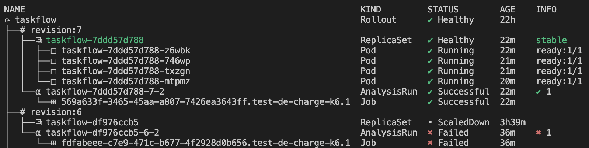


## Lab C : la mini-PSSI en quality gates

### 1. Tableau règle → contrôle → outil → preuve

| Règle | Exigence | Contrôle  | Outil | Preuve |
|---|---|---|---|---|
| **R1** | Tag d'image explicite, jamais latest | Règle Rego deny si le tag est absent ou égal à `latest` | conftest | PR bloquée : `PSSI-R1`<br>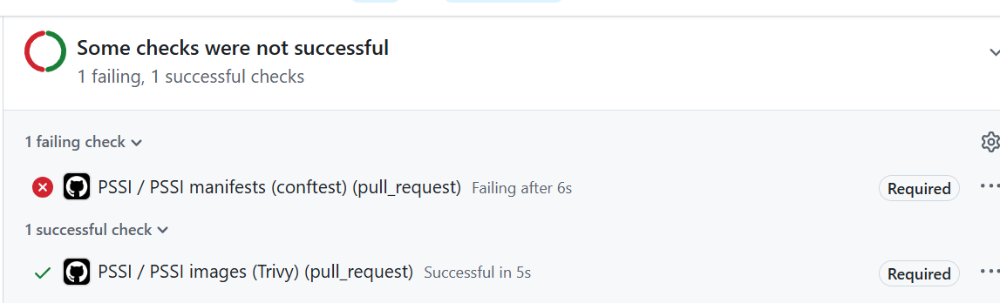 |
| **R2** | Images du registre `ghcr.io/9m7fjfpv9k-cyber/` uniquement | Règle Rego `deny` si l'image ne vient pas du registre autorisé | conftest | Même PR bloquée : `PSSI-R2`<br> |
| **R3** | Limite de mémoire sur chaque conteneur | Règle Rego `deny` si resources.limits.memory est absent | conftest | Règle écrite dans policies/kubernetes.rego, PR #18<br>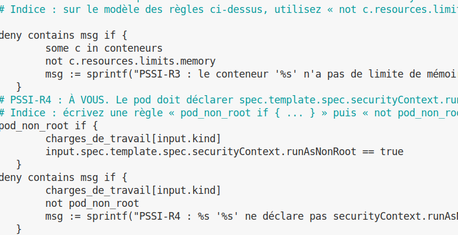 |
| **R4** | Pods jamais en root (`runAsNonRoot: true`) | Règle Rego `deny` si `securityContext.runAsNonRoot` n'est pas `true` | conftest | Échec initial, puis succès après correctif, PR #18<br>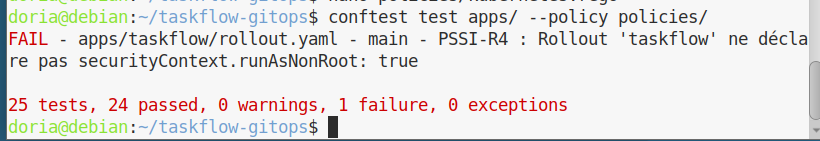<br>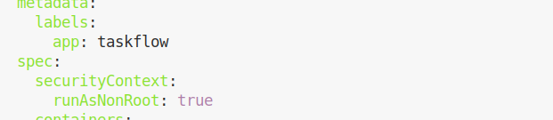<br>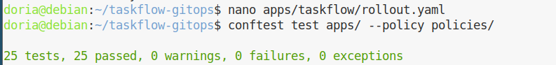 |
| **R5** | Aucune vulnérabilité HIGH ou CRITICAL corrigeable | Scan Trivy avec `--severity HIGH,CRITICAL --ignore-unfixed --exit-code 1` | Trivy | Scan rouge, puis vert avec exceptions datées<br>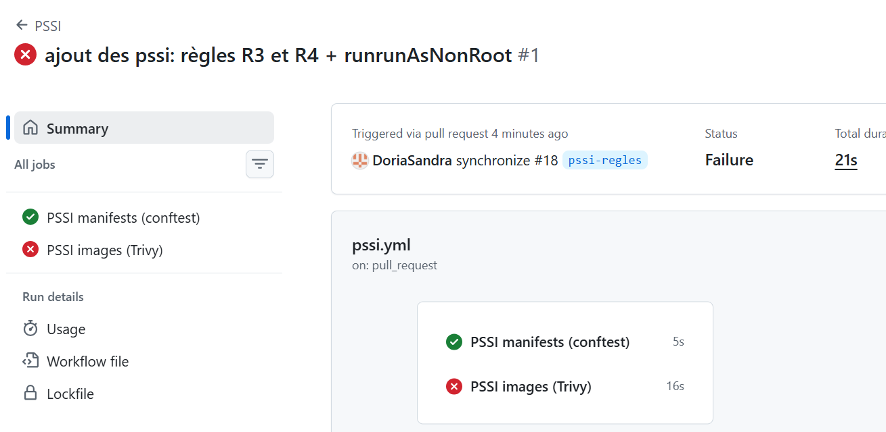<br>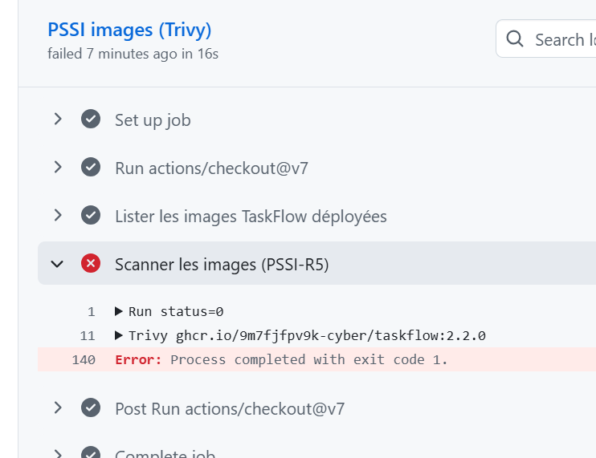<br>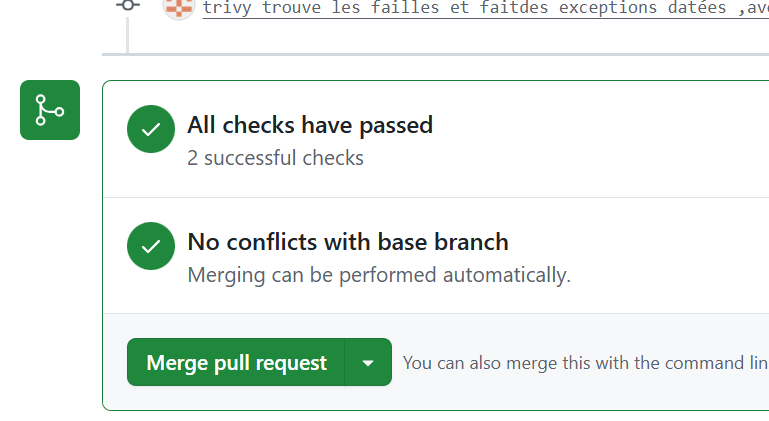 |


### 2. Mise en œuvre

**Étape 1 : état de départ.** Les règles R1 et R2 étaient déjà écrites dans `policies/kubernetes.rego`. R3 et R4 étaient à écrire : tant qu'elles n'existent pas, rien ne les vérifie. `conftest` affichait donc « tout passe » (15 tests, 0 échec).

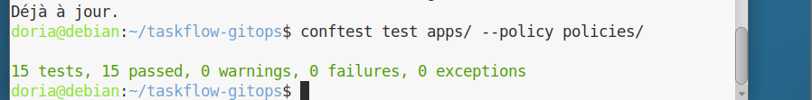

**Étape 2 : écriture de R3 et R4** dans policies/kubernetes.rego, sur le modèle des règles R1 et R2.


Le nombre de tests passe de 15 à 25, et notre Rollout **échoue sur R4** : il n'avait pas de securityContext.


**Étape 3 : correction de R4.** Ajout dans apps/taskflow/rollout.yaml, sous `spec.template.spec` :

yaml
      securityContext:
        runAsNonRoot: true


Cela fonctionne parce que l'image déclare `USER 10001` : un identifiant **numérique**, que Kubernetes peut vérifier comme étant différent de root. Résultat : `25 tests, 25 passed, 0 failures`.


**Étape 4 : le workflow `.github/workflows/pssi.yml`**, copié depuis exemples/ci/pssi-github.yml (PR #18). Il s'exécute à chaque Pull Request vers main et comporte deux jobs :

| Job (nom du check) | Ce qu'il fait |
|---|---|
| `PSSI manifests (conftest)` | Lance `conftest test apps/ --policy policies/` (R1 à R4) |
| `PSSI images (Trivy)` | Scanne chaque image `ghcr.io/9m7fjfpv9k-cyber/...` listée dans `apps/` (R5) |

Au premier passage, `conftest` est vert et Trivy est rouge :


**Étape 5 : checks rendus obligatoires.** Dans le ruleset de main, j'ai ajouté PSSI manifests (conftest) et PSSI images (Trivy) comme Required status checks. Un check rouge qui n'est pas obligatoire n'est qu'un avis : c'est le ruleset qui transforme la règle en blocage.

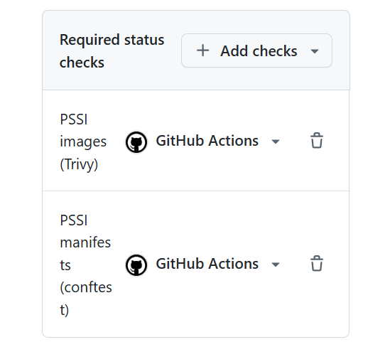

### 3. Preuve : une PR non conforme est bloquée

La PR #19 (branche non-conforme) remplace l'image par nginx:latest. Le check `PSSI manifests (conftest)` est devenu rouge, les deux checks portent le badge Required, et le merge est resté bloqué :

```
FAIL - apps/taskflow/rollout.yaml - main - PSSI-R1 : le conteneur 'taskflow' utilise le tag latest (nginx:latest)
FAIL - apps/taskflow/rollout.yaml - main - PSSI-R2 : l'image du conteneur 'taskflow' ne vient pas du registre autorisé (nginx:latest)
25 tests, 23 passed, 0 warnings, 2 failures,
